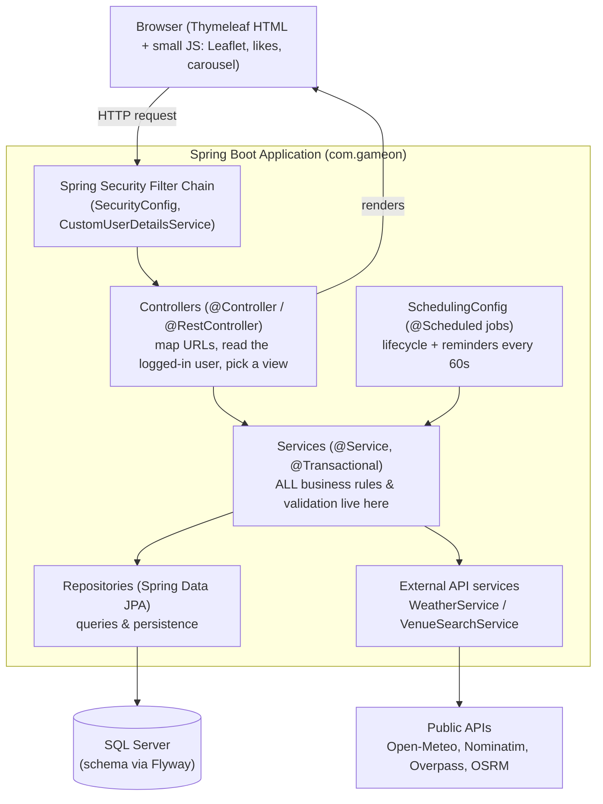
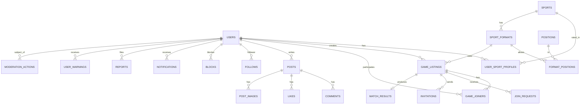
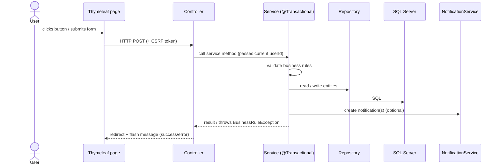

# Game On — Architecture and Use Case Implementation Guide

> **Purpose of this document.** This is a panel-preparation guide for the Game On final university
> project. It explains how the system is built, where each use case lives in the code, and how the
> complex workflows actually behave — so any team member can confidently explain *what happens in the
> code* when a feature is used, and *where to find it*, without memorising every line.
>
> Everything here was derived by reading the actual source. Where a feature is only partially
> implemented, is a known quirk, or differs from what the use-case name suggests, it is flagged
> explicitly with **⚠ Note**. Nothing has been invented.

---

## Table of Contents

1. [Overall System Architecture](#1-overall-system-architecture)
2. [How a Use Case Works in Code (format)](#2-how-a-use-case-works-in-code)
3. [Formal Use Case Coverage (A / B / C / D series)](#3-formal-use-case-coverage)
4. [Complex Workflows in Depth](#4-complex-workflows-in-depth)
5. [Important Technical Concepts](#5-important-technical-concepts)
6. [Potential Panel Questions and Suggested Answers](#6-potential-panel-questions-and-suggested-answers)

---

# 1. Overall System Architecture

## 1.1 In one paragraph

Game On is a **server-rendered web application** built with **Spring Boot**. The browser requests
HTML pages; the server builds those pages with **Thymeleaf** templates and handles form submissions.
There is no separate JavaScript front-end framework — the "front end" is HTML templates plus small
pieces of inline/vanilla JavaScript for a few interactive bits (likes, maps, image carousels). The
back end is a classic layered Spring application: **Controllers** receive web requests, **Services**
hold the business rules, and **Repositories** talk to a **Microsoft SQL Server** database through
**Spring Data JPA / Hibernate**. The database schema is created and versioned by **Flyway**
migrations. Security (login, roles, access control) is handled by **Spring Security**. Some work
happens automatically in the background on a timer (**scheduled tasks**), and a few features call
**external public APIs** for weather and venue/map data.

## 1.2 Languages, frameworks and technologies (verified from `pom.xml` and config)

| Area | Technology | Evidence |
|------|-----------|----------|
| Language | **Java 21** (compiler target 17) | `pom.xml` `<java.version>21</java.version>`, compiler plugin `source/target 17` |
| Framework | **Spring Boot 3.2.5** | `spring-boot-starter-parent` 3.2.5 |
| Web / MVC | **Spring MVC** (`spring-boot-starter-web`) | server-rendered `@Controller`s |
| View layer | **Thymeleaf** + `thymeleaf-extras-springsecurity6` | `spring-boot-starter-thymeleaf` |
| Security | **Spring Security 6** | `spring-boot-starter-security` |
| Persistence | **Spring Data JPA / Hibernate** | `spring-boot-starter-data-jpa` |
| Validation | **Jakarta Bean Validation** | `spring-boot-starter-validation` |
| Database | **Microsoft SQL Server** | `mssql-jdbc`, `SQLServerDialect` |
| Migrations | **Flyway** (`flyway-core` + `flyway-sqlserver`) | `V1`…`V22` scripts |
| Connection pool | **HikariCP** | configured in `application.properties` |
| Local dev DB | **H2** | `runtime` scope, `local` profile only |
| Monitoring | **Spring Boot Actuator** (`/actuator/health`) | starter-actuator |
| Testing | **JUnit / Spring Boot Test / Spring Security Test** | `test` scope |
| Maps JS | **Leaflet** (via `unpkg.com`, OpenStreetMap tiles) | CSP in `SecurityConfig` |

**Database mode:** `spring.jpa.hibernate.ddl-auto=validate` — Hibernate never creates or alters
tables; Flyway owns the schema and Hibernate only checks that the entities match it. `open-in-view`
is **false**, which is why services deliberately fetch what the view needs (e.g. DTO projections and
explicit image queries) rather than relying on lazy loading in the template.

## 1.3 Layered architecture (why it is organised this way)



**Why layered?** Each layer has one responsibility, which keeps the code testable and easy to
reason about:

- **Controllers** are thin. They resolve the current user (`@AuthenticationPrincipal
  CustomUserDetails`), call a service, and return a view name or a redirect. They should contain no
  business rules.
- **Services** are where the rules live (`@Transactional`). This gives us one place to enforce
  validation, and one transaction boundary per operation.
- **Repositories** are interfaces; Spring Data generates the implementation. Complex reads use
  `@Query` JPQL.

This separation is exactly why the test suite can unit-test services (`GameListingServiceTest`,
`ListingLifecycleServiceTest`, etc.) without a running web server.

## 1.4 Package map (where things are)

```
com.gameon
├── GameOnApplication.java         # @SpringBootApplication entry point
├── config/                        # SecurityConfig, SchedulingConfig, FlywayConfig,
│                                  # WebConfig, HttpClientConfig, DataInitializer, etc.
├── controller/                    # Web endpoints (Listings, Lobby, GameJoiner, Social,
│                                  # Moderator, Report, MatchResult, Notification, Auth, ...)
├── service/                       # Business logic (one service per domain area)
├── repository/                    # Spring Data JPA repositories
├── model/
│   ├── entity/                    # JPA @Entity classes (the database tables)
│   ├── enums/                     # Status/type enums (ListingStatus, JoinerStatus, ...)
│   └── dto/                       # Read projections & view models (PostFeedDto, WeatherForecast...)
├── dto/                           # Form-binding DTOs (RegisterStep1Dto, ResetPasswordDto, ...)
├── security/                      # CustomUserDetails(Service), PlainTextPasswordEncoder,
│                                  # SecurityUtils, event + failure handlers
└── exception/                     # Custom exceptions + GlobalExceptionHandler
```

## 1.5 Controllers and their responsibilities

| Controller | Base path | Responsibility |
|-----------|-----------|----------------|
| `ListingsController` | `/listings` | Browse listings (A200), the multi-step create wizard (A100), edit/manage a listing (C300) |
| `GameJoinerController` | `/game-joiner` | Join requests (A300), confirm attendance (A400), leave (A600), claim last-call (A500) |
| `LobbyController` | `/lobby` | The user's hub: created/joined games, pending requests (C500), accept/reject, last-call offers, creator confirm, match history |
| `MatchResultController` | `/match-result` | Record (C100), update (C200), view results (C400) |
| `SocialController` | `/social` | Posts (B100/B200/B300), likes (B600), comments (B700/B800), feed |
| `ReportController` | `/report` | Report a user (D600) / report a post (D700) |
| `ModeratorController` | `/moderator` | Reports queue + full moderation (B400), account management (B900) — **admin only** |
| `LeaderboardController` | `/leaderboard` | Global sport leaderboards (B500) |
| `NotificationController` | `/notifications` | List, mark read, open/navigate notifications (D500), decline invitations |
| `ProfileController` | `/profile` | View/edit profile (D200/D400), add sport (D300), follow/block |
| `UserSearchController` | `/users` | `@RestController` — JSON user-search for the navbar |
| `MapWeatherController` | `/api` | `@RestController` — proxies weather/venue/geocode/route APIs |
| `AuthController` | `/` | Login page, registration wizard (D100), forgot/reset password |
| `GlobalModelAdvice` | — | `@ControllerAdvice` that adds navbar data (unread count, avatar) to every page |

## 1.6 Services and business logic (one service per concern)

`GameListingService` (create/browse/update/cancel), `GameJoinerService` (join/accept/confirm/leave/
last-call), `ListingLifecycleService` (the T-24h→T-1h automated lifecycle), `SchedulingConflictService`
(double-booking detection), `InvitationService`, `MatchResultService` (results + stats),
`LeaderboardService` + `FriendsLeaderboardService`, `PostService`/`CommentService`/`LikeService`/
`FollowService`/`BlockService` (social), `ReportService`/`ModerationService`/`WarningService`
(moderation), `NotificationService`, `UserService`/`ProfileService`/`SportService`/`AuthService`
(accounts), `AvatarStorageService`/`ImageStorageService` (uploads), `WeatherService`/
`VenueSearchService`/`PlayabilityService` (external integrations).

## 1.7 Repositories and data access

All repositories extend `JpaRepository`. Simple lookups use Spring Data method-name queries
(e.g. `existsByIdUserIdAndIdSportId`); complex reads use `@Query` JPQL. Two patterns worth knowing:

- **DTO projections** — the social feed selects straight into `PostFeedDto` with `COUNT` subqueries
  for like/comment counts, so no lazy collections are touched (safe with `open-in-view=false`).
- **Bulk status updates** — `@Modifying` queries such as `lockAllConfirmedJoiners` and
  `expirePendingForListing` update many rows in one statement at finalisation.

## 1.8 Models / entities and the database

The schema is created by Flyway (`V1__Create_Tables.sql` builds 16 core tables; `V2…V22` add seed
data, indexes, constraints, the workflow redesign, venue fields, blocking, moderation, post images,
and notification-type expansions). Entities mirror those tables.



Key entity facts:

- **`GameListing`** (`game_listings`) — `creator` and `format` are **EAGER**; `joiners` and
  `matchResult` are LAZY. Capacity = `format.getNoPlayers()`; each team caps at `noPlayers / 2`.
  A `@Transient getEffectiveStatus()` derives `IN_PROGRESS` / `AWAITING_RESULT` from the clock for
  `CONFIRMED` games. **No `@Version` field** (no optimistic locking).
- **`GameJoiner`** (`game_joiners`) — composite key `GameJoinerId(userId, gameListingId)`. Carries
  `team`, `status`, `attendanceConfirmedAt`, `lateWithdrawal`, position prefs. `setStatus()` bumps
  `updatedAt`.
- **`JoinRequest`** — `status`, `team`, position prefs, optional `invitation`, and
  `lastCallApproved` (column `is_last_call_approved`).
- **`MatchResult`** — one-to-one with `GameListing` via a **unique** FK (`game_listing_id`), which
  enforces "one result per listing" at the database level. `@Transient getWinners()` returns
  `TEAM_A` / `TEAM_B` / `DRAW`.
- **`User`** — `username` (unique), `password`, `typeOfUser` (role), `accountStatus`,
  `warningCount`, ban fields, and `static final int STRIKES_FOR_BAN = 3`.
- **`UserSportProfile`** — composite key `(userId, sportId)`, holds `skillLevel`, `wins`, `losses`,
  `winPercentage` and `calculateWinPercentage()`. This is the stats table the leaderboards read.

### Core enums

| Enum | Values |
|------|--------|
| `ListingStatus` | `OPEN`, `CONFIRMED`, `CANCELLED_INSUFFICIENT_PLAYERS`, `CANCELLED_BY_CREATOR`, `COMPLETED` |
| `JoinerStatus` | `ACCEPTED`, `CONFIRMED_ATTENDANCE`, `LOCKED`, `LEFT` |
| `JoinRequestStatus` | `PENDING`, `ACCEPTED`, `REJECTED`, `WITHDRAWN`, `EXPIRED` |
| `InvitationStatus` | `PENDING`, `USED`, `DECLINED`, `EXPIRED` |
| `PrivacySetting` | `PUBLIC`, `PRIVATE`, `FOLLOWERS` (⚠ `PRIVATE` is defined but not offered in create/edit) |
| `AccountStatus` | `ACTIVE`, `SUSPENDED`, `BANNED` |
| `UserRole` | `USER`, `ADMIN` |
| `ReportStatus` / `ReportType` | `PENDING/DISMISSED/RESOLVED` ; `USER/POST` |
| `Team` | `A`, `B` |

## 1.9 Authentication and authorisation

Configured in `config/SecurityConfig.java` (`@EnableWebSecurity`, `@EnableMethodSecurity`):

- **Form login** at `/login`; on success a custom handler sends admins to `/moderator/reports` and
  users to `/listings`. Logout at `/logout` clears the session and `JSESSIONID`.
- **URL rules:** static assets, uploads, auth pages and `/actuator/health` are public;
  `/moderator/**` and `/admin/**` require `ROLE_ADMIN`; everything else needs authentication.
- **CSRF** is **on** (cookie-based token for Thymeleaf), only disabled for the H2 console.
- **Users are loaded** by `CustomUserDetailsService.loadUserByUsername`. `CustomUserDetails` maps the
  role to `ROLE_USER`/`ROLE_ADMIN` and makes `isEnabled()`/`isAccountNonLocked()` return true **only
  when `accountStatus == ACTIVE`**, so suspended/banned users cannot log in.
- **Banned/suspended UX:** `ModerationAwareAuthenticationFailureHandler` detects the
  `DisabledException`/`LockedException` and redirects to `/login?banned` or `?suspended` with the
  reason, strike count and ban date.
- **⚠ Note — passwords:** the `PasswordEncoder` bean is `PlainTextPasswordEncoder`, which stores and
  compares passwords **in plain text** (its javadoc calls this "the approved GameOn specification").
  This is an intentional academic simplification, not production-grade security — be ready to say so.

## 1.10 Scheduled tasks and background processing

`config/SchedulingConfig.java` (`@EnableScheduling`) runs **five jobs every 60 seconds**
(`@Scheduled(fixedRate = 60000)`), each delegating to `ListingLifecycleService` and catching
per-listing errors so one failure never halts the batch:

1. `processConfirmationDeadlines()` — the **T-2h** deadline.
2. `sendConfirmationReminders()` — nudges unconfirmed players.
3. `sendDeadlineApproachingReminders()` — the **T-5h** reminder.
4. `finaliseListings()` — the **T-1h** confirm/cancel decision.
5. `sendMissingResultReminders()` — reminds the organiser to post a score after the game ends.

## 1.11 External integrations (maps, venues, weather)

All external calls go through one shared `RestTemplate` (`HttpClientConfig`, 5s connect / 20s read
timeout), are **keyless** public APIs, are **cached in memory**, and **fail softly**.

| Service | API(s) | What it does | On failure |
|---------|--------|--------------|-----------|
| `WeatherService` | **Open-Meteo** | Hourly forecast near the match time; 30-min cache keyed by ~1 km grid | returns `WeatherForecast.unavailable()` |
| `VenueSearchService` | **Nominatim** (geocode), **Overpass** (venue discovery), **OSRM** (routes) | Finds SA sports venues, geocodes places, driving routes; 15-min cache | returns a `VenueSearchOutcome` status (`RATE_LIMITED`/`TIMEOUT`/`UNAVAILABLE`) → HTTP 429/503 |
| `PlayabilityService` | — | Rates weather `GOOD/FAIR/POOR/UNKNOWN` for the sport/venue | indoor → GOOD; no forecast → UNKNOWN |

`MapWeatherController` (`/api/**`) proxies these server-side so the browser never calls them
directly and the Content-Security-Policy can stay strict.

---

# 2. How a Use Case Works in Code

Every use case in Section 3 follows the same structure so you can scan quickly:

- **What it does** — plain functional description.
- **Where it starts** — the page/button/trigger.
- **Key code components** — template → controller endpoint → service method → repository → helpers.
- **Step-by-step code flow** — the real sequence from action to response.
- **Business rules** — where the important validations live.
- **Technical points** — notable design choices (transactions, scheduling, concurrency, algorithms).
- **Panel explanation** — a ~30–60 second spoken answer in your own voice.

A reminder of the common request pattern (true for almost every web use case):



When a service throws a `BusinessRuleException` / `ResourceNotFoundException` /
`UnauthorizedAccessException`, either the controller catches it and shows a flash message, or
`GlobalExceptionHandler` renders the matching error page (400/403/404/409/500).

---

# 3. Formal Use Case Coverage

## A-Series — Game Listings and Attendance

### Use Case: Create Game Listing (A100)

**What it does:** Lets a signed-in user publish a game others can join, choosing sport/format, skill,
date/time, location (optionally a mapped venue), positions, and friends to invite.

**Where it starts:** `GET /listings/create` → `listings/create.html` (the "Create a game" button).
It is a **multi-step wizard** backed by an `HttpSession` draft (`CreateListingDraft`).

**Key code components:**
- Templates: `listings/create.html` → `create-positions.html` → `create-friends.html` → `create-confirm.html`.
- Controller: `ListingsController` (`processCreate`, `processCreatePositions`, `processCreateFriends`, `confirmCreate`).
- Service: `GameListingService.createListing(...)`, `validateListingDetails(...)`, `validatePositionSelection(...)`; plus `SchedulingConflictService` and `InvitationService`.
- Repositories: `GameListingRepository`, `GameJoinerRepository`, `UserSportProfileRepository`.

**Step-by-step code flow:**
1. `POST /listings/create` (`processCreate`) checks the chosen format belongs to the chosen sport, parses date/skill/privacy, reads `durationMinutes` from the format, runs `validateListingDetails(...)`, and stores a `CreateListingDraft` in the session.
2. If the format has positions → redirect to the positions step; otherwise straight to the friends step.
3. The friends step offers only the user's friends (`followService.getFriendIds`) and validates the invited IDs are a subset of them.
4. `POST /listings/confirm` (`confirmCreate`) calls `GameListingService.createListing(...)` inside one `@Transactional` method:
   - Re-validates everything (BR8 sport-on-profile, start ≥ now+3h, duration matches the format, scheduling conflict).
   - Saves the `GameListing`.
   - **Creates the creator as a participant:** `new GameJoiner(creator, listing, Team.A)` with status `ACCEPTED` (and the first/second selected positions).
   - `InvitationService.createInvitations(...)` writes `PENDING` invitation rows.
   - Sends `LISTING_INVITE` notifications to invited friends.
5. Clears the session draft and redirects to `/listings` with a success flash.

**Business rules:** All in `GameListingService.validateListingDetails` / `validatePositionSelection`:
BR8 the sport must be on the creator's profile; must be created ≥ 3 hours before start; duration 1–480
and must equal the format's duration; no scheduling conflict (60-min travel buffer); positions must be
valid for the format (empty list = "Any position").

**Technical points:** Wizard state held in the HTTP session (not the DB) until final confirm.
Capacity/teams are driven by `format.getNoPlayers()` and `noPlayers/2`. Invitations are **courtesy
only** — an invitee still has to submit a join request; being invited just waives the
sport-on-profile rule.

**Panel explanation:** "Creating a listing is a short wizard whose draft lives in the session. On the
final confirm we call `GameListingService.createListing`, which re-validates the sport is on the
user's profile, that it's at least three hours ahead, and that they don't already have a clashing
game. We save the listing, immediately add the creator as an accepted participant on Team A, create
any invitations, and notify invited friends — all in one transaction."

---

### Use Case: Browse Listings (A200)

**What it does:** Shows public, upcoming games that match the user's sports and that they can still join.

**Where it starts:** `GET /listings` → `listings/index.html` (filters: sport, skill, date, hide-full).

**Key code components:** `ListingsController.index` → `GameListingService.browseAvailableListings(...)`
→ `GameListingRepository.searchAvailablePublicListings[ExcludingBlocked]`.

**Step-by-step code flow:**
1. The controller reads filters and calls `browseAvailableListings`.
2. The service resolves the user's sport IDs → format IDs (empty → empty page), computes the browse
   cutoff (`now + 1h`), and, if the user has blocks, calls the `…ExcludingBlocked` query variant.
3. The query returns only `PUBLIC`, `OPEN` listings with `scheduledDate > now+1h`, excluding the
   user's own and any they already joined, with optional sport/skill/date filters and `hideFull`.
4. The controller attaches a participant count per listing for display.

**Business rules:** You can only browse sports on your own profile; private listings never appear;
listings disappear from browse at **T-1h**; mutually-blocked creators are hidden.

**Technical points:** Filtering (privacy, cutoff, blocks, already-joined) is done **in the database
query**, not in Java — efficient and consistent.

**Panel explanation:** "Browse is a filtered query. We translate the user's sports into formats, then
the repository returns only public, open, future games they haven't joined, hiding anything past the
one-hour cutoff or involving a blocked user. Blocking and privacy are enforced in the SQL, not in
memory."

---

### Use Case: Send Join Request (A300)

**What it does:** A user asks to join someone else's listing, picking a team and (if applicable) positions.

**Where it starts:** `GET /game-joiner/join/{listingId}?team=` → `game-joiner/join.html`; submit is
`POST /game-joiner/join/{listingId}`.

**Key code components:** `GameJoinerController.submitJoinRequest` → `GameJoinerService.sendJoinRequest(...)`
→ `JoinRequestRepository`, `InvitationRepository`, `SchedulingConflictService`, `NotificationService`.

**Step-by-step code flow:**
1. `sendJoinRequest` validates (in order): request window open (OPEN and before T-1h); not the
   creator; not mutually blocked; not already accepted/locked; no existing pending request;
   **BR9** sport-on-profile unless a live invitation exists; valid positions; no scheduling conflict.
2. Saves a `PENDING` `JoinRequest` (linking an invitation and flipping it to `USED` if present).
3. Notifies the creator with `JOIN_REQUEST_RECEIVED`.

**Business rules:** All in `sendJoinRequest`. Note capacity is **not** checked here — it is enforced
when the creator accepts.

**Technical points:** The invitation link lets invited friends bypass the sport-profile rule. One
pending request per user per listing is enforced.

**Panel explanation:** "Joining sends a request, it doesn't auto-join. The service checks the window
is open, the user isn't blocked, hasn't already requested, and has no time clash, then stores a
pending request and notifies the organiser. Capacity is checked later at accept time."

---

### Use Case: Confirm Attendance (A400)

**What it does:** An accepted participant (or the creator) confirms they will actually show up.

**Where it starts:** participant button `POST /game-joiner/confirm/{listingId}`; creator button
`POST /lobby/created/{listingId}/confirm`. Both call `GameJoinerService.confirmAttendance`.

**Key code components:** `GameJoinerService.confirmAttendance(userId, listingId)` →
`ListingLifecycleService.isConfirmationWindowOpen` → `GameJoinerRepository` → `NotificationService`.

**Step-by-step code flow:**
1. Listing must be `OPEN` and the confirmation window open (**T-24h to T-1h**).
2. The user's `GameJoiner` must currently be `ACCEPTED` (not LEFT, not already confirmed/locked).
3. Status becomes `CONFIRMED_ATTENDANCE` and `attendanceConfirmedAt` is stamped.
4. If the confirmer isn't the creator, the creator gets an `ATTENDANCE_CONFIRMED` notification.

**Business rules:** Window + current-status checks in `confirmAttendance`.

**Technical points:** The timestamp is the audit trail that the T-2h and T-1h jobs use to decide who
is kept vs released.

**Panel explanation:** "Confirming flips the participant's row from `ACCEPTED` to
`CONFIRMED_ATTENDANCE` and records the time. That timestamp is what the scheduled deadline jobs later
use to keep confirmed players and drop the ones who never confirmed."

---

### Use Case: Claim Last-Call Place (A500)

**What it does:** In the final window before a game (**T-2h to T-1h**), if a confirmed player drops
out, the creator can offer the spot to pending requesters, who then race to claim it.

**Where it starts:** creator sends offers `POST /lobby/requests/{listingId}/last-call`; a player
claims `POST /game-joiner/claim/{listingId}`.

**Key code components:** `GameJoinerService.approveLastCallRequesters(...)` and
`claimLastCallPlace(...)`; `ListingLifecycleService.isInLastCallPeriod`; `JoinRequestRepository`,
`GameJoinerRepository`.

**Step-by-step code flow:**
1. **Offer:** `approveLastCallRequesters` verifies the creator, that it's the last-call window, and
   that a place is free; for each selected requester it sets `lastCallApproved = true` and sends a
   `LAST_CALL_OFFER` notification. Eligible pending players come from
   `JoinRequestRepository.findPendingForLastCall`.
2. **Claim:** `claimLastCallPlace` re-validates everything at claim time — listing OPEN, still in the
   window, the user holds a `lastCallApproved` pending request, overall capacity, team capacity, and
   scheduling conflict.
3. On success it writes the `GameJoiner` straight to `CONFIRMED_ATTENDANCE` (a claim counts as
   confirmation), flips the request to `ACCEPTED`, and notifies the claimer (`LAST_CALL_CLAIMED`) and
   creator (`LAST_CALL_PLACE_FILLED`).

**Business rules:** Only `lastCallApproved` pending requesters, only in the window, only while capacity
and team capacity allow. During this window the creator **cannot** accept normally — replacements must
go through last-call so no spot is silently reserved.

**Technical points — simultaneous claims:** Concurrency is handled by **re-counting participants
inside each claim's transaction** (`countCurrentParticipants >= noPlayers` → "already filled").
**⚠ Note:** there is **no pessimistic lock, no `@Version`, and no unique-seat DB constraint**. Under
the default isolation level two perfectly simultaneous claims could both pass the count check and
overfill by one. This is the single most important concurrency caveat in the project — name it
honestly and describe how you'd fix it (a row lock / unique seat / optimistic version).

**Panel explanation:** "Last-call is our replacement mechanism for the final two hours. The organiser
offers the free spot to pending requesters; whoever clicks claim first gets it. Each claim re-checks
capacity, team balance and time clashes inside its transaction before committing. It's first-come
based on that re-count — we didn't add a database-level lock, so in theory two exactly simultaneous
claims could both succeed, which is the known limitation we'd harden with a seat constraint."

---

### Use Case: Leave Game Listing (A600)

**What it does:** A non-creator withdraws from a game or cancels their pending request.

**Where it starts:** `POST /game-joiner/leave/{listingId}` (from the Joined tab).

**Key code components:** `GameJoinerService.leaveListing(userId, listingId)` →
`ListingLifecycleService.isPastFinalisation`/`isInLastCallPeriod`, `GameJoinerRepository`,
`JoinRequestRepository`, `NotificationService`.

**Step-by-step code flow:**
1. Creator cannot leave (must cancel instead); no withdrawal past **T-1h**; listing must be `OPEN`;
   a `LOCKED` participant cannot leave (BR6).
2. If an active participant row exists, set it to `LEFT`, mark `lateWithdrawal` if in the T-2h→T-1h
   window, and notify the creator (`JOIN_WITHDRAWN`, flagged "late" when applicable).
3. Otherwise withdraw the pending request (`WITHDRAWN`) and remove its notification.

**Business rules:** Time-window + locked checks in `leaveListing`.

**Panel explanation:** "Leaving either withdraws a pending request or marks an accepted participant as
`LEFT`. We block it once the roster is locked at T-1h, and if someone leaves inside the last two hours
we flag it as a late withdrawal and tell the organiser so they can trigger a last-call replacement."

---

### Use Case: Send Game Reminders (A700)

**What it does:** Automatically nudges participants and organisers at the right times.

**Where it starts:** Not a user action — the `@Scheduled` jobs in `SchedulingConfig` (every 60s).

**Key code components:** `ListingLifecycleService.sendConfirmationReminders`,
`sendDeadlineApproachingReminders`, `sendMissingResultReminders`; de-duplicated by
`NotificationService.hasNotification`.

**Step-by-step code flow:**
1. Each minute, finder queries pick listings in the relevant window.
2. For each unconfirmed accepted player the service sends a reminder (`ATTENDANCE_REMINDER` ~T-24h,
   `ATTENDANCE_CONFIRMATION_DEADLINE` ~T-5h), and the organiser a missing-result reminder after the
   game ends.
3. Before every send it checks `hasNotification(recipient, listing, type)` and skips if one already
   exists, so the per-minute jobs don't spam.

**Technical points:** The implemented milestones are **T-24h** (window opens / reminders), **T-5h**
(deadline approaching), **T-2h** (deadline processing), **T-1h** (finalisation), and **end+2h**
(missing result). There is no separate "T-1h reminder" — T-1h is the finalisation action itself.

**Panel explanation:** "Reminders are scheduled jobs that run every minute, find games in each time
window, and message only the people who still need to act. We guard every send with a
`hasNotification` check so running every minute never produces duplicates."

---

### Use Case: Hide Expired Listings (A800)

**What it does:** Keeps past/finished games out of browse and the lobby tabs.

**Where it starts:** No dedicated job or button — it's enforced **declaratively in queries**.

**Key code components:** `GameListingRepository.searchAvailablePublicListings` (browse cutoff
`now + 1h`, status `OPEN`), `findCreatedByUser` / `findJoinedListingsForUser` (`scheduledDate > now`),
`findMatchHistoryForUser` (`scheduledDate <= now`).

**Technical points:** Expiry is implicit: a listing simply stops matching the date/status predicates,
so it falls out of the active views and (once started) appears in Match History instead.

**Panel explanation:** "We don't delete or hide expired games with a job — our browse and lobby
queries already filter on date and status, so a game naturally drops off the active lists once it's
within an hour of starting or already finished, and started confirmed games move into match history."

---

### Use Case: Confirm Session (A900)

**What it does:** Decides, just before kick-off, whether the game is actually happening.

**Where it starts:** No manual endpoint — the **T-1h** scheduled job `finaliseListings` →
`ListingLifecycleService.finaliseListing`.

**Step-by-step code flow (summary; full detail in §4.2):**
1. Release any still-unconfirmed non-creator participants.
2. If the creator confirmed **and** confirmed participants ≥ `format.noPlayers` → status `CONFIRMED`,
   lock everyone, expire outstanding requests/invitations, notify `LISTING_CONFIRMED`.
3. Otherwise → `CANCELLED_INSUFFICIENT_PLAYERS` (creator-unconfirmed or too few players), notify.

**⚠ Note:** there is no distinct "creator did not confirm" status — that case reuses
`CANCELLED_INSUFFICIENT_PLAYERS` with a different notification type.

**Panel explanation:** "Session confirmation is automatic. One hour before kick-off a scheduled job
checks the organiser confirmed and there are enough confirmed players; if so the game becomes
`CONFIRMED` and everyone's spot is locked, otherwise it's cancelled and everyone is told why."

## B-Series — Social and Moderation

### Use Case: Create Posts (B100)

**What it does:** A user publishes a post with text and/or up to 4 images, visible to everyone
(`PUBLIC`) or just followers (`FOLLOWERS`).

**Where it starts:** `GET /social/create` → `social/create.html`; submit `POST /social/create`
(multipart).

**Key code components:** `SocialController.createPost` → `PostService.createPost(userId, content,
privacy, images)` → `ImageStorageService.store`, `PostRepository`.

**Step-by-step code flow:**
1. `createPost` validates there is non-blank text **or** at least one image, and ≤ 4 images (`MAX_IMAGES_PER_POST`).
2. Each image is validated and stored via `ImageStorageService`; if a later file fails, already-stored files are rolled back.
3. A `Post` plus its ordered `PostImage` rows are saved (cascade); redirect to the feed.

**Business rules:** Text-or-image required; max 4 images. BR4: no limit on number of posts.

**Technical points:** Image **files** live on disk under a UUID filename; only the URL path is stored
in the DB. Display order is assigned 1..N in upload order.

**Panel explanation:** "Creating a post validates that there's text or at least one image, stores up
to four image files on disk under random filenames, and saves the post with the image URLs. If one
upload fails we clean up the ones already written so we never leave orphan files."

---

### Use Case: Manage Posts (B200)

**What it does:** The owner edits a post's text/privacy/images or deletes it.

**Where it starts:** `GET/POST /social/edit/{postId}`; `POST /social/delete/{postId}`.

**Key code components:** `PostService.updatePost(...)` and `deletePost(postId, userId)`.

**Step-by-step code flow:**
- **Edit:** owner check (else `UnauthorizedAccessException`); keep surviving images, delete removed
  ones, append new ones (cap 4); renumber display order; save; delete removed files only after a
  successful save.
- **Delete:** owner check, then **soft-remove** — set `removedAt` (and leave `removedBy` null to mean
  "author-removed"). The row, its comments, likes and reports are all kept.

**Business rules:** Only the owner can edit/delete; text-or-image still required after edits.

**Technical points:** Soft-removal (not hard delete) preserves moderation history and referential
integrity. Active queries filter `removedAt IS NULL`, so removed posts vanish from the feed and
cannot be liked or commented on (`RemovedPostInteractionTest`).

**Panel explanation:** "Editing and deleting are owner-only. Delete is a soft-remove — we set a
`removedAt` timestamp instead of deleting the row, so comments, likes and any report that referenced
it survive, and the post simply stops appearing because every active query filters on `removedAt IS
NULL`."

---

### Use Case: Browse Posts (B300)

**What it does:** Shows the social feed with correct privacy and blocking applied.

**Where it starts:** `GET /social?page=&filter=ALL|FOLLOWING|MY_POSTS` → `social/feed.html`;
single post `GET /social/post/{postId}`.

**Key code components:** `SocialController.feed` → `PostService.getFilteredFeed(userId, filter,
pageable)` → the `PostRepository` DTO-projection queries.

**Step-by-step code flow:**
1. The service computes the user's "block wall" (`blockService.getBlockedUserIds`) once.
2. It picks a repository query based on the filter and whether blocks exist:
   - **ALL:** public posts + followers-only from followed authors + the user's own posts.
   - **FOLLOWING:** all visible posts from followed authors only.
   - **MY_POSTS:** the user's own posts regardless of privacy.
3. All queries project into `PostFeedDto` with `COUNT` subqueries for likes/comments, filter
   `removedAt IS NULL`, and (when blocked) add `author NOT IN :blockedUserIds`.
4. Batch enrichers attach images, author avatars and the viewer's liked-state in one query each.

**Business rules:** Privacy is enforced **inside the queries** — a followers-only post is only ever
returned when its author is in the followed list, so URL-tampering can't surface it.

**Technical points:** DTO projections + batch enrichment avoid `LazyInitializationException` (needed
because `open-in-view=false`) and the N+1 query problem.

**Panel explanation:** "The feed is a privacy-aware query. Public posts show to everyone, followers-
only posts only to followers, and we exclude anyone you've blocked — all in the SQL. We project
straight into a DTO with count subqueries so we never touch lazy collections, and we batch-load
images, avatars and like-state to avoid N+1 queries."

---

### Use Case: Manage Reports (B400)

**What it does:** Moderators review the report queue and act: dismiss, warn, remove-and-warn, suspend,
or ban. Every action is audited.

**Where it starts:** `GET /moderator/reports` → `moderator/reports.html` (admin-only).

**Key code components:** `ModeratorController` (class-level `@PreAuthorize("hasRole('ADMIN')")`);
`ReportService`, `WarningService`, `UserService`, `ModerationService`.

**Step-by-step code flow (per action):**
1. Load the report, resolve the target user.
2. Apply the action: `dismissReport`; or `issueStrike` + `resolveReport`; or `issueStrike` +
   `resolvePostReport` (which soft-removes the post); or `suspendUser`/`banUser` + `resolveReport`.
3. Write a `ModerationAction` audit row via `moderationService.logAction(...)`.

**Business rules:** BR13 — only admins moderate (enforced by `@PreAuthorize` + the `/moderator/**`
URL rule). Strikes auto-ban at 3 (see B900/§4.6).

**Technical points:** Each action is one transaction that both changes state and writes an immutable
audit record, so the moderation log can never drift from reality.

**Panel explanation:** "The moderator queue is admin-only, enforced both by the URL rule and
`@PreAuthorize`. Each decision — dismiss, warn, remove-and-warn, suspend, ban — resolves the report,
applies the effect, and writes an audit row in a single transaction, so we always have a complete,
tamper-proof moderation history."

---

### Use Case: View Leaderboards (B500)

**What it does:** Ranks players by win percentage within a sport (plus a friends leaderboard on the profile).

**Where it starts:** `GET /leaderboard?sportId=` → `social/leaderboard.html`.

**Key code components:** `LeaderboardController` → `LeaderboardService.getLeaderboard(sportId,
pageable)` → `UserSportProfileRepository.findTopBySportOrderByWinPercentageDesc`;
`FriendsLeaderboardService.getFriendsLeaderboard(userId)` for the profile page.

**Step-by-step code flow:**
1. The global board orders `UserSportProfile` rows for a sport by `winPercentage DESC`, counting only
   players who have played at least one game.
2. The friends board aggregates `SUM(wins)` and `SUM(wins+losses)` across sports for the user's
   friends (following ∪ followers) and ranks by **total wins**.

**Technical points:** Ranking reads directly off the pre-computed `UserSportProfile` stats, so the
leaderboard is a simple ordered query — no recomputation at read time.

**Panel explanation:** "Leaderboards read the per-sport stats we keep on each user's sport profile and
order by win percentage. Because we update those stats when a result is recorded, the board is just a
sorted query — fast and always current."

---

### Use Case: Like Post (B600)

**What it does:** Toggles a like on a post.

**Where it starts:** `POST /social/like/{postId}` (form) or `.../ajax` (returns JSON for in-place update).

**Key code components:** `SocialController.toggleLike` / `toggleLikeAjax` →
`LikeService.toggleLike(userId, postId)`.

**Step-by-step code flow:** Load the active post (removed posts throw), then if a `Like` exists delete
it (returns false) else save a new one (returns true); the AJAX endpoint returns the new count.

**Technical points:** `Like` has a composite key `(userId, postId)`, so a user can like a post only
once. The AJAX path is progressive enhancement; the form POST is the no-JavaScript fallback.

**Panel explanation:** "Liking is a toggle keyed on user plus post, so you can only like once. There's
an AJAX endpoint that updates the heart in place and returns the new count, with a plain form POST as
the fallback if JavaScript is off."

---

### Use Case: Post Comment (B700)

**What it does:** Adds a comment to a post.

**Where it starts:** `POST /social/comment/{postId}`.

**Key code components:** `CommentService.addComment(userId, postId, text)`.

**Step-by-step code flow:** Load user and the active post (removed posts reject comments), save a
`Comment`, and if the commenter isn't the author send a `POST_COMMENTED` notification.

**Panel explanation:** "Commenting saves a comment against an active post and, unless you're commenting
on your own post, notifies the author with a clickable notification back to the post."

---

### Use Case: Delete Comment (B800)

**What it does:** Removes a comment.

**Where it starts:** `POST /social/comment/delete/{commentId}`.

**Key code components:** `CommentService.deleteComment(commentId, userId, isModerator)`.

**Step-by-step code flow:** Authorisation is **owner OR moderator**; otherwise
`UnauthorizedAccessException`. Comments are **hard-deleted** (unlike posts, which are soft-removed).

**Panel explanation:** "A comment can be deleted by its author or a moderator. Unlike posts, comments
are hard-deleted — we didn't need to preserve them for moderation history."

---

### Use Case: Manage User Account (B900)

**What it does:** Account-level state: self-service password reset, and admin suspend/ban/reinstate.

**Where it starts:** password reset `POST /forgot-password`; admin actions under `/moderator/users`.

**Key code components:** `AuthService.resetPassword`; `UserService.suspendUser` / `banUser` /
`reinstateUser` / `activateUser` / `resetWarningCount`; `WarningService.issueStrike` / `reverseWarning`.

**Step-by-step code flow:**
- **Reset:** validate passwords match and the username exists, then set the new password; errors are
  shown generically so internal/DB details never leak.
- **Suspend/Ban/Reinstate:** flip `accountStatus` (`SUSPENDED`/`BANNED`/`ACTIVE`) with attribution.
  Users are **never physically deleted** — history is preserved.

**⚠ Note:** there is no self-service account deletion/deactivation; deactivation only exists as
moderation.

**Panel explanation:** "Account management is split: users can reset their own password, while
suspend, ban and reinstate are moderator actions that only flip an account-status flag — we never
delete a user, so their history stays intact. Three strikes flips the account to banned
automatically."

---

## C-Series — Match Results and Listing Management

### Use Case: Record Match Result (C100)

**What it does:** The creator records the final score after a confirmed game ends; player stats update.

**Where it starts:** `GET /match-result/submit/{listingId}` → `match-result/form.html`; submit
`POST /match-result/submit/{listingId}`.

**Key code components:** `MatchResultController.showSubmitForm`/submit →
`MatchResultService.recordResult(listingId, creatorId, teamAScore, teamBScore)`.

**Step-by-step code flow:**
1. Creator-only check; scores ≥ 0; the game must be `CONFIRMED` and already finished (now ≥ session end).
2. **BR10** one result per listing (`existsByGameListingGameListingId`, also a unique FK).
3. Save the `MatchResult`, set the listing `COMPLETED`, update participant stats, notify participants
   (`MATCH_RESULT_POSTED`).

**Business rules:** Creator-only; non-negative scores; confirmed + finished; one result per game.

**Technical points:** Stats update only the `LOCKED` participants (the finalised roster); a draw
changes nobody's wins/losses. See §4.4.

**Panel explanation:** "Only the organiser records the score, and only after a confirmed game has
finished. We save one result per game — enforced by a unique foreign key — mark the listing completed,
and update every locked participant's win/loss stats based on their team, then notify everyone."

---

### Use Case: Update Match Result (C200)

**What it does:** Corrects a previously recorded score.

**Where it starts:** `POST /match-result/update/{listingId}`.

**Key code components:** `MatchResultService.updateResult(...)`.

**Step-by-step code flow:** BR11 creator-only; scores ≥ 0; game must be `COMPLETED`; capture old
winner; update scores; **only if the winner changed**, reverse the old stats and apply the new ones;
notify `MATCH_RESULT_UPDATED`.

**Technical points:** Reversing stats floors wins/losses at 0 (`Math.max`), so corrections never
produce negative counts.

**Panel explanation:** "If the organiser corrects a score, we only touch stats when the actual winner
changes — we reverse the old outcome and apply the new one, flooring at zero so nobody ends up with
negative wins."

---

### Use Case: Manage Game Listing (C300)

**What it does:** The creator edits or cancels their own listing.

**Where it starts:** `GET/POST /listings/edit/{id}`; cancel from the lobby.

**Key code components:** `GameListingService.updateListing(...)`, `validateEditable`, `cancelListing`,
`isCreatorCancellable`.

**Step-by-step code flow:**
- **Edit:** allowed only while `OPEN` and nobody else has an active request/participation
  (`validateEditable`); a date change re-runs the scheduling-conflict check.
- **Cancel:** blocked once `CONFIRMED`/finished or within T-1h; sets `CANCELLED_BY_CREATOR`, expires
  pending requests/invitations, and notifies everyone (`LISTING_CANCELLED`).

**Business rules:** Creator-only; no edits once others have joined; no cancel inside the last hour.

**Panel explanation:** "Only the creator manages their listing. We let them edit while it's open and
nobody else has joined, and cancel up until the last hour — cancelling expires all pending requests
and invitations and notifies everyone who was involved."

---

### Use Case: View Match Results (C400)

**What it does:** Shows a game's final score and roster, plus a user's match history.

**Where it starts:** `GET /match-result/view/{listingId}`; history at `/lobby/history`.

**Key code components:** `MatchResultService.getResultForListing`, `getMatchHistory(userId)` →
`MatchResultRepository.findMatchHistoryForUser`.

**Panel explanation:** "Viewing a result loads the score and the team rosters; the history page lists
every completed game where the user was the creator or a locked participant."

---

### Use Case: View Join Requests (C500)

**What it does:** The creator reviews pending requests and accepts/rejects (and sends last-call offers).

**Where it starts:** `GET /lobby/requests/{listingId}` → `lobby/requests.html` (creator-only).

**Key code components:** `LobbyController` → `GameJoinerService.getPendingRequests`, `acceptRequest`,
`rejectRequest`, `approveLastCallRequesters`.

**Step-by-step code flow:** `acceptRequest` re-validates the window, **refuses direct accept during
last-call** (replacements go through last-call), enforces overall and team capacity, re-checks the
requester's scheduling conflict, creates the `GameJoiner` as `ACCEPTED`, and sends `JOIN_ACCEPTED`.
`rejectRequest` refuses to reject someone who holds an outstanding last-call offer.

**Panel explanation:** "The organiser sees pending requests and accepts or rejects them. Accepting
re-checks capacity, team balance and the requester's schedule before adding them. In the final two
hours direct accepts are disabled so replacements fairly go through the last-call claim flow."

## D-Series — Accounts and Profiles

### Use Case: Register User (D100)

**What it does:** Creates an account over two steps (credentials, then sports) and logs the user in.

**Where it starts:** `GET /register` → `auth/register.html`, then `/register-sports`.

**Key code components:** `AuthController.processRegister` / `processRegisterSports` →
`AuthService.registerStep1` / `registerStep2`; `RegisterStep1Dto`, `RegisterStep2Dto`.

**Step-by-step code flow:**
1. **Step 1:** validate username/password (`@Valid`), passwords match, username free; create the
   `User` (role `USER`, status `ACTIVE`); stash the new id + raw password in the session; redirect
   to step 2.
2. **Step 2:** require at least one sport; create a `UserSportProfile` per selected sport/skill.
3. **Auto-login:** authenticate with the stored credentials, set the `SecurityContext`, clear the
   registration session attributes, redirect to `/listings`.

**Business rules:** Username unique; passwords match and meet size rules; at least one sport.

**Panel explanation:** "Registration is two steps held in the session: first the account, then at
least one sport with a skill level. After step two we authenticate the user automatically and drop
them on the listings page."

---

### Use Case: Manage User Profile (D200)

**What it does:** View your own profile, change your username, upload a profile picture.

**Where it starts:** `GET /profile`, `GET/POST /profile/edit`, `POST /profile/picture`.

**Key code components:** `ProfileController`, `ProfileService.updateProfilePicture`,
`UserService.updateUsername`, `AvatarStorageService`.

**Step-by-step code flow:** The edit form updates the username (dup-checked). The avatar upload
validates the image (extension + MIME + magic bytes, ≤ 5 MB), stores it under a UUID filename, saves
the URL on the user, then best-effort deletes the old file.

**Technical points:** Only the image **URL** is persisted; the binary is on disk and served statically
from `/uploads/profile-pictures/**`.

**Panel explanation:** "Profile management covers changing your username and uploading an avatar. We
validate the image by extension, MIME type and magic bytes, store it under a random filename, and keep
only the URL in the database."

---

### Use Case: Add Sport (D300)

**What it does:** Adds another sport (with skill level) to the user's profile.

**Where it starts:** `GET/POST /profile/add-sport`.

**Key code components:** `ProfileService.addSportToProfile(userId, sportId, skillLevel)`.

**Step-by-step code flow:** Load user + sport; reject if the sport is already on the profile
(`DuplicateResourceException`); else save a new `UserSportProfile`. Removing a sport is blocked if it
would leave the user with none.

**Panel explanation:** "Adding a sport creates a new user-sport-profile row with a skill level, as long
as it isn't already there. We also stop you removing your last sport, since listings and browse depend
on having at least one."

---

### Use Case: View User Profile (D400)

**What it does:** View another user's profile, posts and results — subject to blocking.

**Where it starts:** `GET /profile/{userId}` (also `/posts`, `/results`).

**Key code components:** `ProfileController.viewProfile` → `BlockService.isBlockedEitherWay`,
`ProfileService`, `FollowService.isFollowing`.

**Step-by-step code flow:** Viewing yourself redirects to `/profile`. If there is a block in either
direction → the `profile/unavailable` page. Otherwise show profile, sports, follower/following counts,
follow state and friends leaderboard.

**Business rules:** Mutual blocking hides the profile both ways, even via direct URL.

**Panel explanation:** "Viewing someone's profile first checks for a block in either direction — if
there is one, we show an 'unavailable' page instead, so blocking works even if you paste the URL
directly."

---

### Use Case: View Notifications (D500)

**What it does:** Lists the user's notifications, marks them read, and makes relevant ones clickable
through to the right page.

**Where it starts:** `GET /notifications` → `notifications/index.html`.

**Key code components:** `NotificationController` → `NotificationService.getNotificationsForUser`,
`getClickableNotificationIds`, `openNotification`, `markAsRead` / `markAllAsRead`.

**Step-by-step code flow:**
1. List the user's notifications (newest first) plus active invitations and the unread count.
2. `getClickableNotificationIds` works out which ones resolve to a destination.
3. `POST /notifications/open/{id}` → `openNotification` loads the notification **scoped to its owner**,
   resolves a destination from its type + linked entity, marks it read, and redirects.

**Business rules / access restriction:** Every read/open query is scoped by `recipient.userId`, so a
user can only ever see or open **their own** notifications. Post-linked notifications additionally
check `existsVisibleToUser` so you can't reach a post you shouldn't see.

**Technical points:** `resolveDestination` is a `switch` on `NotificationType` that maps each type to a
route (e.g. `JOIN_REQUEST_RECEIVED` → `/lobby/requests/{id}`, `MATCH_RESULT_POSTED` →
`/match-result/view/{id}`, `FOLLOW_NEW` → `/profile/{actorId}`). Types with no sensible target are
non-clickable.

**Panel explanation:** "Notifications are per-user — every query is filtered by the recipient, so you
can't open someone else's. Each notification stores links to the listing, request, post or result it's
about, and a switch on its type turns that into the correct URL. Opening one marks it read and
redirects, and for post notifications we re-check you're actually allowed to see that post."

---

### Use Case: Report User (D600) / Report Post (D700)

**What it does:** Lets a user report another user (which also blocks them) or report a post.

**Where it starts:** `GET/POST /report/user/{userId}`, `GET/POST /report/post/{postId}` →
`report/form.html`.

**Key code components:** `ReportController` → `ReportService.reportAndBlockUser(...)` (D600) and
`createReport(...)` (D700).

**Step-by-step code flow:**
- **D600:** `reportAndBlockUser` creates a `USER` report **and** blocks the reported user in one
  transaction (both succeed or neither does). Reporting is not an auto-ban — only the mutual block is
  applied.
- **D700:** `createReport` stores a `POST` report against the active post.

**Business rules:** Can't report yourself; a post report must reference an existing active post. BR12:
no limit on how many reports a user can file.

**Panel explanation:** "Reporting a user files a report and blocks them in the same transaction, so you
never end up with one without the other. Reporting a post just files it for a moderator. Reporting
doesn't punish anyone automatically — it feeds the moderator queue."

---

## Other Important Functionality (no formal ID)

| Feature | Where it lives | How it works |
|---------|---------------|--------------|
| **Login** | Spring Security form login (`SecurityConfig`) | `POST /login` → `DaoAuthenticationProvider` → `CustomUserDetailsService` + `PlainTextPasswordEncoder`; role-based redirect on success |
| **Logout** | `SecurityConfig` logout config | `POST /logout` invalidates the session, deletes `JSESSIONID`, redirects to `/login?logout=true` |
| **Banned/suspended login** | `ModerationAwareAuthenticationFailureHandler` + `CustomUserDetails` | non-ACTIVE accounts fail `isEnabled()`/`isAccountNonLocked()`; handler redirects with the specific reason/strikes/date |
| **Invitations** | `InvitationService`, `NotificationController` | courtesy invites (PENDING rows + `LISTING_INVITE`); an invitee still submits a join request, but the invite waives the sport-on-profile rule; can be declined |
| **Blocking** | `BlockService` | single source of truth `isBlockedEitherWay`; blocking is mutual and removes follows, expires pending invites/requests both ways, and clears cross notifications |
| **Post privacy** | `PostService` + `PostRepository` queries | PUBLIC vs FOLLOWERS enforced inside the feed/detail SQL (see §4.5) |
| **Clickable notifications** | `NotificationService.resolveDestination` | owner-scoped; maps each `NotificationType` to a route and re-checks visibility for post links |
| **Individual participation statuses** | `GameJoinerService`, `JoinerStatus` | each `GameJoiner` moves `ACCEPTED → CONFIRMED_ATTENDANCE → LOCKED`, or `LEFT`; tracked independently per player with timestamps |
| **User search** | `UserSearchController` (`/users/search`) | `@RestController` JSON for the navbar; active users only, block-filtered, capped at 10 |
| **Strikes / bans / reactivation** | `WarningService`, `UserService` | 3 strikes = auto-ban; immutable `UserWarning` audit; reversal lifts a strike-only ban (see §4.6) |

---

# 4. Complex Workflows in Depth

## 4.1 Game Listing Creation

- **Form processing & validation.** The wizard holds a `CreateListingDraft` in the `HttpSession`
  across steps; nothing is persisted until the final `POST /listings/confirm`. Validation happens
  twice — once per step for fast feedback, and definitively in
  `GameListingService.validateListingDetails` at confirm time (sport-on-profile BR8, start ≥ now+3h,
  duration matches the format, scheduling conflict).
- **Sport formats & team capacities.** A `SportFormat` carries `noPlayers` and `hasPositions`. Total
  capacity = `noPlayers`; each team (A/B) caps at `noPlayers / 2`. Positions are only used when
  `hasPositions` is true, and must belong to the format (`sportService.getPositionIdsForFormat`).
- **Creator becomes a participant.** Right after the listing is saved, the service creates
  `new GameJoiner(creator, listing, Team.A)` with status `ACCEPTED` — so the organiser always counts
  toward capacity and must themselves confirm attendance later.
- **Scheduling conflicts.** `SchedulingConflictService.getConflictMessageMinutes` builds the new
  session's `[start, end]` plus a **60-minute travel buffer**, loads the user's other upcoming
  open/confirmed games, and flags an overlap in either direction. Used on create, join, accept and
  last-call claim.
- **Invitations.** `InvitationService.createInvitations` de-dupes IDs, rejects self-invites and
  blocked users, and writes `PENDING` invitations; invited friends get a `LISTING_INVITE`
  notification. Invitations never auto-join — they are a courtesy that waives the sport-profile rule.

## 4.2 Attendance Confirmation and Listing Lifecycle

```mermaid
stateDiagram-v2
    [*] --> OPEN: created (creator = ACCEPTED)
    OPEN --> OPEN: players join & confirm\n(ACCEPTED -> CONFIRMED_ATTENDANCE)
    state "T-2h processConfirmationDeadline" as T2
    state "T-1h finaliseListing" as T1
    OPEN --> T2: scheduled job (every 60s)
    T2 --> OPEN: release unconfirmed non-creators;\nwarn creator; keep window open
    OPEN --> T1: scheduled job (every 60s)
    T1 --> CONFIRMED: creator confirmed AND\nconfirmed >= noPlayers (lock everyone)
    T1 --> CANCELLED_INSUFFICIENT_PLAYERS: creator not confirmed OR too few
    CONFIRMED --> COMPLETED: match result recorded
```



- **Milestone detection.** Time constants live in `ListingLifecycleService`:
  `CONFIRMATION_WINDOW_HOURS = 24`, `CONFIRMATION_DEADLINE_HOURS = 2`, `FINALISATION_HOURS = 1`.
  Each scheduled job uses a finder query (e.g. `findListingsNeedingFinalisation(now + 1h)`) to pick
  listings in the right window. The **T-5h** reminder is a separate finder (`now+2h`…`now+5h`).
- **Recording individual attendance.** `confirmAttendance` (A400) and `claimLastCallPlace` (A500) set
  `CONFIRMED_ATTENDANCE` and stamp `attendanceConfirmedAt`.
- **Releasing unconfirmed participants.** At **T-2h**, `processConfirmationDeadline` sets every
  unconfirmed non-creator to `LEFT` (notifying `PLACE_RELEASED_UNCONFIRMED`) and gives the creator a
  grace period but an urgent warning. The listing is **not** yet confirmed or cancelled — this opens
  the last-call window.
- **Finalisation.** At **T-1h**, `finaliseListing` releases any stragglers, then:
  - creator confirmed **and** `confirmedCount >= noPlayers` → `CONFIRMED`, **lock everyone**
    (`lockAllConfirmedJoiners`: `CONFIRMED_ATTENDANCE → LOCKED`), expire pending requests/invitations,
    bulk-notify `LISTING_CONFIRMED`;
  - otherwise → `CANCELLED_INSUFFICIENT_PLAYERS` with the appropriate cancellation notification.
- **LOCKED status.** Only set at finalisation. A LOCKED player can no longer leave, and a CONFIRMED
  game can no longer be cancelled; the locked roster is exactly who match-result stats apply to.
- **Avoiding duplicate notifications.** Because the jobs run every minute, every reminder/warning send
  is guarded by `NotificationService.hasNotification(recipient, listing, type)`.

## 4.3 Last-Call System

- **Detecting available places.** Any time `countCurrentParticipants < format.noPlayers` during the
  T-2h→T-1h window (`isInLastCallPeriod`).
- **Eligible pending players.** `JoinRequestRepository.findPendingForLastCall` returns all pending
  requesters (invited-first ordering, no normal cutoff).
- **Sending offers.** `approveLastCallRequesters` marks each selected request `lastCallApproved = true`
  and sends a `LAST_CALL_OFFER` notification.
- **Processing claims.** `claimLastCallPlace` re-validates at claim time (window, approval, overall &
  team capacity, scheduling conflict), then writes the participant straight to `CONFIRMED_ATTENDANCE`.
- **Simultaneous claims / capacity & eligibility.** Enforced by re-counting participants **inside each
  claim's transaction**. **⚠ There is no DB lock, `@Version`, or unique-seat constraint**, so two
  exactly simultaneous claims could both pass the count check under default isolation — a known,
  honestly-acknowledged limitation. The realistic fix is a pessimistic row lock on the listing, an
  optimistic `@Version`, or a unique seat/slot constraint.

## 4.4 Match Results

- **Submission & validation.** `recordResult` — creator-only, scores ≥ 0, game must be `CONFIRMED`
  and finished, and one result per listing (BR10, backed by a unique FK).
- **Association with listings.** `MatchResult` is one-to-one with `GameListing` via the unique
  `game_listing_id` FK; recording a result also flips the listing to `COMPLETED`.
- **Statistics.** `updateParticipantStats` reads the **LOCKED** roster, works out each player's team
  outcome, and increments `wins` or `losses` on their `UserSportProfile` (a draw changes nothing),
  then recomputes `winPercentage`. Corrections (C200) reverse the old outcome first (floored at 0).
- **Leaderboard impact.** Because stats are stored on `UserSportProfile`, leaderboards update
  implicitly — the next leaderboard query simply re-orders the changed rows by `winPercentage`.

## 4.5 Notifications

- **Creation.** `NotificationService.createNotification(recipientId, text, type, actor, listing,
  joinRequest, matchResult, post)` (with shorter overloads) and `createBulkNotifications(...)` for
  many recipients. Each notification stores foreign keys to whatever it's about (listing / request /
  post / result / actor).
- **Which services generate them.** Join/accept/reject/leave and last-call from `GameJoinerService`;
  confirmation/finalisation/cancellation/reminders from `ListingLifecycleService`; results from
  `MatchResultService`; follows from `FollowService`; comments from `CommentService`; strikes from
  `WarningService`; invites from `GameListingService`.
- **Scheduled notifications.** The lifecycle reminders (§4.2), all de-duplicated by `hasNotification`.
- **Clickable navigation.** `resolveDestination` maps each `NotificationType` to a route using the
  linked entity; the list page only renders a clickable button for ids that resolve.
- **Access restrictions.** Owner-scoped queries (`findOwnedForOpening`, `markAsReadForUser`) — a user
  can only see/open/read their own; post-linked notifications additionally require `existsVisibleToUser`.

## 4.6 Social Features and Moderation

- **Post privacy.** Enforced inside the feed/detail SQL: PUBLIC to everyone, FOLLOWERS only to
  followers (and the owner). A followers-only post is only returned when its author is in the viewer's
  followed list, so it cannot be reached by URL-tampering. (⚠ `PRIVATE` exists in the enum but isn't
  offered in create/edit.)
- **Likes / comments / follows / blocking.** Likes and follows use composite keys so they're
  inherently idempotent; comments are hard-deleted by owner or moderator. `BlockService` is the single
  source of truth — a block is mutual, removes follows both ways, expires pending invites/requests both
  ways, and clears cross notifications, while preserving historical data.
- **Reports → strikes → bans → reactivation.** A report feeds the moderator queue. A moderator action
  can `issueStrike`, which writes an immutable `UserWarning`, increments `warningCount`, and at
  **3 strikes (`User.STRIKES_FOR_BAN`)** auto-sets `BANNED`. `reverseWarning` decrements the active
  count (audit record kept) and, if a strike-only ban now falls below the threshold, lifts the ban back
  to `ACTIVE`. Suspend/ban/reinstate flip `accountStatus` with full attribution; every moderation
  action is logged via `ModerationService.logAction` into `ModerationAction`.

---

# 5. Important Technical Concepts

Only concepts actually used in Game On are listed. Each has a concrete example and why it matters.

### Dependency Injection
**Where:** everywhere — e.g. `GameJoinerService` receives `GameListingRepository`,
`GameJoinerRepository`, `SchedulingConflictService`, `NotificationService`, etc. through its
constructor; `SecurityConfig` injects `CustomUserDetailsService` and `UserRepository`.
**Why it matters:** Spring wires collaborators automatically, so classes depend on interfaces rather
than creating their own dependencies — which is what makes the service unit tests (with mocked
repositories) possible.

### Separation of Concerns (layering)
**Where:** controller → service → repository (§1.3). Controllers never contain business rules;
services own them; repositories own persistence.
**Why it matters:** one obvious place to change a rule, and the ability to test business logic without
the web or database layers.

### Database Transactions
**Where:** `@Transactional` on service methods — e.g. `createListing` (listing + creator-joiner +
invitations + notifications all commit together), `finaliseListing` (status change + bulk lock +
expiries), `reportAndBlockUser` (report + block atomically).
**Why it matters:** multi-step operations are all-or-nothing, so we never leave half-finished state
such as a report without its block or a confirmed listing with unlocked players.

### Entity Relationships
**Where:** composite keys (`GameJoinerId`, `UserSportProfileId`, `LikeId`, `FollowId`, `BlockId`),
one-to-many (`GameListing` → `GameJoiner`), one-to-one with a **unique FK** (`GameListing` ↔
`MatchResult`), many-to-many via join tables (`format_positions`, `user_sport_profiles`).
**Why it matters:** the model mirrors the domain, and constraints like the unique match-result FK
enforce rules ("one result per game") at the database level, not just in code.

### Authentication and Authorisation
**Where:** `SecurityConfig` (form login, URL rules, CSRF, session rules), `CustomUserDetails`
(role mapping + account-status gating), `@PreAuthorize("hasRole('ADMIN')")` on `ModeratorController`,
plus programmatic ownership checks in services (e.g. creator-only `recordResult`).
**Why it matters:** two layers of defence — URL/role rules for whole areas, and per-record ownership
checks for individual actions.

### Scheduled Jobs
**Where:** `SchedulingConfig` — five `@Scheduled(fixedRate = 60000)` jobs driving the T-24h→T-1h
lifecycle and reminders.
**Why it matters:** time-based transitions (confirm/cancel games, send reminders) happen reliably
without any user clicking anything.

### Database Migrations
**Where:** Flyway `V1…V22` under `db/migration`, orchestrated by `FlywayConfig` (repair then migrate).
With `ddl-auto=validate`, Flyway owns the schema and Hibernate only checks the entities match.
**Why it matters:** the schema is versioned, repeatable and reviewable — every structural change is a
tracked script, not an ad-hoc `ALTER`.

### Error Handling and Validation
**Where:** Bean Validation annotations on entities/DTOs (`@NotBlank`, `@Size`, `@Min`); custom
exceptions (`BusinessRuleException`, `ResourceNotFoundException`, `UnauthorizedAccessException`,
`DuplicateResourceException`); a central `@ControllerAdvice` `GlobalExceptionHandler` mapping each to
the right page/status (400/403/404/409/500).
**Why it matters:** consistent, user-friendly errors and one place that guarantees internal details
(stack traces, SQL) never leak to users.

### Concurrency and Data Consistency
**Where:** the last-call claim re-counts participants inside its transaction (§4.3);
`NotificationService.hasNotification` de-duplicates the per-minute scheduled sends; `WeatherService`
and `VenueSearchService` use per-key locks to collapse concurrent identical fetches.
**Why it matters:** these keep behaviour sensible under concurrent use. **⚠ Be honest:** the last-call
check is not a true database lock, so it is the one place where a tight race could overfill a game —
a known limitation with a clear fix (row lock / `@Version` / unique seat constraint).

### Caching (external APIs)
**Where:** `WeatherService` (30-min, ~1 km grid) and `VenueSearchService` (15-min) use in-memory
`ConcurrentHashMap` caches with per-key fetch de-duplication.
**Why it matters:** fewer calls to rate-limited public APIs and faster responses, without a caching
dependency.

---

# 6. Potential Panel Questions and Suggested Answers

**Q: Why did you choose this architecture?**
A: We used a standard layered Spring Boot MVC app — controllers, services, repositories — because it
keeps responsibilities separate and testable. Controllers just handle the web, services hold all the
business rules behind transactions, and Spring Data repositories handle persistence. Server-rendered
Thymeleaf fit a university project with no need for a separate front-end stack, and Spring Security,
Flyway and JPA gave us production-style security, migrations and persistence without much boilerplate.

**Q: What happens in the code when someone creates a listing?**
A: It's a short wizard whose draft lives in the session. On final confirm, `GameListingService.create
Listing` runs in one transaction: it re-validates the sport is on the user's profile, the start is at
least three hours away, the duration matches the format and there's no scheduling clash; saves the
listing; immediately adds the creator as an accepted participant on Team A; creates any invitations;
and notifies invited friends.

**Q: How do you prevent scheduling conflicts?**
A: `SchedulingConflictService` builds the proposed game's time window plus a 60-minute travel buffer,
loads the user's other upcoming open or confirmed games, and checks for any overlap in either
direction. We run that check on create, join, accept and last-call claim, so a user can't be
double-booked.

**Q: How does the system know when to send attendance reminders?**
A: `SchedulingConfig` has jobs that run every minute. They query for listings sitting in each time
window — around 24 hours and 5 hours before kick-off — and message only the players who still haven't
confirmed. Each send is guarded by a `hasNotification` check so running every minute never produces
duplicates.

**Q: How do you ensure a game only becomes confirmed when everybody has confirmed?**
A: One hour before kick-off the `finaliseListing` job checks two things: the organiser has confirmed,
and the number of confirmed participants meets the format's required player count. Only then does the
listing become `CONFIRMED` and everyone's spot locked. If either check fails, it's cancelled and
everyone is notified. Unconfirmed players were already released at the two-hour mark.

**Q: What happens when two users try to claim the final available spot?**
A: Each claim runs in its own transaction and re-counts current participants right before committing;
if the game is already full it rejects with "already filled". So it's first-come based on that
re-count. Honestly, we didn't add a database-level lock or a unique seat constraint, so two exactly
simultaneous claims could in theory both pass the check — that's a known limitation we'd fix with a
pessimistic row lock, an optimistic version column, or a unique slot constraint.

**Q: How are match results linked to player statistics?**
A: A `MatchResult` is one-to-one with its listing through a unique foreign key, so there can only be
one result per game. When the organiser records it, we read the locked roster, and for each player we
increment wins or losses on their per-sport profile based on which team won — a draw changes nothing —
then recompute their win percentage. If a result is corrected and the winner changes, we reverse the
old outcome first.

**Q: How are notifications generated and stored?**
A: Services call `NotificationService.createNotification`, which saves a `Notification` row linked to
whatever it's about — the listing, join request, post, result or actor. For bulk events like
confirming a game we use `createBulkNotifications`. Each one stores a type, and a switch on that type
turns the linked entity into a clickable URL. Users only ever see their own, because every query is
scoped to the recipient.

**Q: How do you enforce post privacy?**
A: Entirely in the database queries. Public posts are visible to everyone, followers-only posts only
to followers and the author, and the feed also excludes anyone you've blocked. Crucially, a
followers-only post is only ever returned when its author is in your followed list, so you can't reach
a private-to-followers post by guessing its URL.

**Q: How do you prevent users from performing actions they are not authorised to perform?**
A: Two layers. Spring Security's URL rules lock whole areas — `/moderator/**` needs the admin role,
everything else needs authentication — and the moderator controller also has `@PreAuthorize`. On top
of that, services do per-record ownership checks: only the creator can record a result or cancel a
listing, only a post's owner can edit it, and notifications are owner-scoped. If a check fails we throw
an exception that the global handler turns into a 403.

**Q: How does the database interact with the application?**
A: Through Spring Data JPA repositories over Hibernate, talking to SQL Server with HikariCP pooling.
The schema itself is owned by Flyway migrations, and Hibernate runs in `validate` mode so it never
changes tables — it just checks the entities match. Simple reads use method-name queries; complex ones
use JPQL, and the feed uses DTO projections so we don't rely on lazy loading, since open-in-view is
off.

**Q: What would happen if an external API became unavailable?**
A: The app keeps working — those features fail softly. Weather calls catch the error and return an
"unavailable" forecast, so playability just shows "unknown". Venue search returns a status like
timeout or rate-limited that the controller maps to an honest message with a retry, rather than a
blank list. Nothing in the core flow — creating games, joining, results — depends on those APIs, and
every external call has a 5-second connect and 20-second read timeout plus caching to reduce load.

---

## Appendix — Known Limitations and Honesty Notes (for the panel)

These are real, from the code — stating them shows you understand your own system:

1. **Passwords are stored in plain text** (`PlainTextPasswordEncoder`), described as the approved
   project specification. Not production-grade; the obvious upgrade is BCrypt.
2. **Last-call claims aren't truly atomic** — concurrency relies on a re-count inside the transaction,
   with no DB lock / `@Version` / unique seat constraint.
3. **`PrivacySetting.PRIVATE`** exists in the enum but isn't offered in create/edit and isn't a
   distinct feed branch (only PUBLIC/FOLLOWERS/own are matched).
4. **Some `NotificationType` values are deliberately non-clickable** (e.g. `JOIN_REJECTED`,
   `STRIKE_ISSUED`, cancellations) because they have no meaningful destination.
5. **`LAST_CALL_FULL`** notification type is defined in the schema but never produced by the services.
6. **No manual "confirm session" (A900) endpoint and no standalone "hide expired" (A800) job** — both
   are handled implicitly (scheduled finalisation, and date/status query predicates respectively).
7. **`UserSearchDto.displayName`** is always null — a planned field not yet on the `User` entity.
8. Opening a notification is a side-effecting navigation (marks read on open) — safe because it's
   owner-scoped, but worth noting as a design choice.
