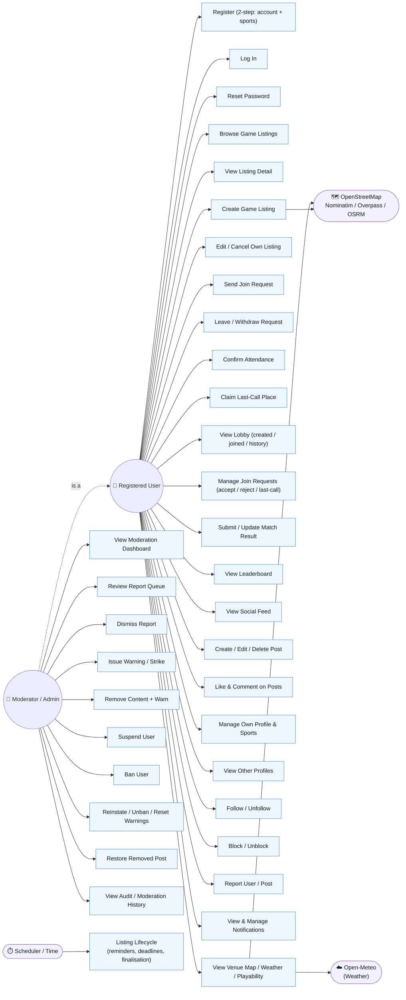

# GameOn — Use Case Diagram

This diagram shows the GameOn actors and the use cases attached to each.

## Actors

- **Registered User (`ROLE_USER`)** — the main player; access to all core gameplay and social features. Ownership (edit own listing, delete own post, etc.) is enforced in code rather than by role.
- **Moderator / Admin (`ROLE_ADMIN`)** — everything a User can do *plus* moderation. (Internally the role is named `ADMIN`, but the UI/URLs treat it as "Moderator".)

### Secondary system actors
Server-side external APIs and the internal scheduler. No payment, email, SMS, or OAuth integrations exist in the codebase.

- **Open-Meteo** — weather forecasts for playability.
- **OpenStreetMap (Nominatim / Overpass / OSRM)** — geocoding, venue discovery, routing.
- **Scheduler / Time** — an internal `@Scheduled` job (runs every 60s) that drives the listing lifecycle (confirmation reminders, deadlines, finalisation).

## Diagram

## Authorization notes (from the code)

- Only `/moderator/**` and `/admin/**` are role-gated (`ROLE_ADMIN`). All other authenticated use cases are open to any logged-in user, with ownership (e.g. *edit own listing*, *delete own post*) enforced in code.
- The Moderator/Admin "is a" Registered User (generalization arrow), so it inherits every User use case plus the moderation set.
- Suspended/banned accounts cannot log in at all — `AccountStatus` gates authentication.
